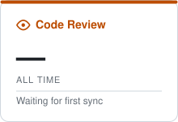
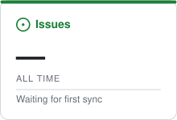
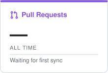
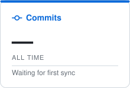

<!-- Profile README for @nvhieu19. Repository must be named exactly "nvhieu19" (nvhieu19/nvhieu19). -->

  
  
  
  
  

 

## About Me

I'm a developer who enjoys building practical things with **Node.js**. I like working on applications and backend services, and I use **Python** for scripting and automation.

Outside of code, I'm drawn to **Windows troubleshooting**, software optimization and **PC hardware** – diagnosing problems and tuning systems for better performance. I'm also curious about **AI tools**, AI-assisted coding and how emerging technologies fit into everyday development.

I'm always learning and building small, useful projects along the way. Alongside my technical work, I work part-time as a manager at McDonald's, where I continue to build leadership, teamwork and operations skills.

 

## Tech Stack & Tools

<table>
  <tr>
    <td align="center" width="140"><b>Backend</b></td>
    <td>
      
    </td>
  </tr>
  <tr>
    <td align="center"><b>Frontend</b></td>
    <td>
      
    </td>
  </tr>
  <tr>
    <td align="center"><b>Database</b></td>
    <td>
      
    </td>
  </tr>
  <tr>
    <td align="center"><b>Dev Tools</b></td>
    <td>
       
      
    </td>
  </tr>
  <tr>
    <td align="center"><b>AI Ecosystem</b></td>
    <td>
      
      
      
      
      
      
    </td>
  </tr>
  <tr>
    <td align="center"><b>Systems & Hardware</b></td>
    <td>
       
      
      
    </td>
  </tr>
</table>

 

## GitHub Statistics

  <a href="https://github.com/nvhieu19">
    <picture>
      <source media="(prefers-color-scheme: dark)" srcset="https://github-profile-summary-cards.vercel.app/api/cards/stats?username=nvhieu19&theme=github_dark" />
      <source media="(prefers-color-scheme: light)" srcset="https://github-profile-summary-cards.vercel.app/api/cards/stats?username=nvhieu19&theme=default" />
      
    </picture>
  </a>
  <a href="https://github.com/nvhieu19?tab=repositories">
    <picture>
      <source media="(prefers-color-scheme: dark)" srcset="https://github-profile-summary-cards.vercel.app/api/cards/repos-per-language?username=nvhieu19&theme=github_dark" />
      <source media="(prefers-color-scheme: light)" srcset="https://github-profile-summary-cards.vercel.app/api/cards/repos-per-language?username=nvhieu19&theme=default" />
      
    </picture>
  </a>

  <a href="https://github.com/nvhieu19">
    <picture>
      <source media="(prefers-color-scheme: dark)" srcset="https://streak-stats.demolab.com/?user=nvhieu19&hide_border=true&background=0D1117&ring=A371F7&fire=58A6FF&currStreakLabel=58A6FF&sideLabels=C9D1D9&currStreakNum=F0F6FC&sideNums=F0F6FC&dates=8B949E" />
      <source media="(prefers-color-scheme: light)" srcset="https://streak-stats.demolab.com/?user=nvhieu19&hide_border=true&background=FFFFFF&ring=8250DF&fire=0969DA&currStreakLabel=0969DA&sideLabels=1F2328&currStreakNum=1F2328&sideNums=1F2328&dates=656D76" />
      
    </picture>
  </a>

  <a href="https://github.com/nvhieu19">
    <picture>
      <source media="(prefers-color-scheme: dark)" srcset="https://github-readme-activity-graph.vercel.app/graph?username=nvhieu19&area=true&hide_border=true&bg_color=0D1117&color=58A6FF&line=A371F7&point=F0F6FC&area_color=1F6FEB" />
      <source media="(prefers-color-scheme: light)" srcset="https://github-readme-activity-graph.vercel.app/graph?username=nvhieu19&area=true&hide_border=true&bg_color=FFFFFF&color=0969DA&line=8250DF&point=1F2328&area_color=0969DA" />
      
    </picture>
  </a>

 

## 📊 Activity Overview

  <picture>
    <source media="(prefers-color-scheme: dark)" srcset="assets/activity/code-review-dark.svg" />
    
  </picture>
  <picture>
    <source media="(prefers-color-scheme: dark)" srcset="assets/activity/issues-dark.svg" />
    
  </picture>
  <picture>
    <source media="(prefers-color-scheme: dark)" srcset="assets/activity/pull-requests-dark.svg" />
    
  </picture>
  <picture>
    <source media="(prefers-color-scheme: dark)" srcset="assets/activity/commits-dark.svg" />
    
  </picture>

Pulled from the GitHub GraphQL API every 6 hours by GitHub Actions. Large numbers are all-time totals; the line below each number shows the last 30 and 7 days. Code Review counts reviews submitted, not pull requests reviewed.

 

## Featured Projects

<!--FEATURED_PROJECTS:START-->

Public Node.js, Python and AI projects will appear here automatically as soon as they are published.

<!--FEATURED_PROJECTS:END-->

 

## Currently Learning

 

 

## Contribution Graph

<picture>
  <source media="(prefers-color-scheme: dark)" srcset="https://ghchart.rshah.org/58A6FF/nvhieu19" />
  <source media="(prefers-color-scheme: light)" srcset="https://ghchart.rshah.org/0969DA/nvhieu19" />
  
</picture>

 

<i>Learning in public, building one project at a time.</i>

